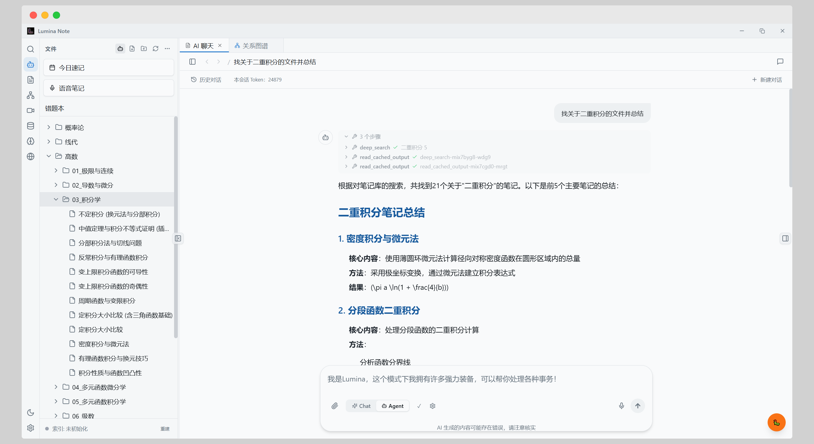
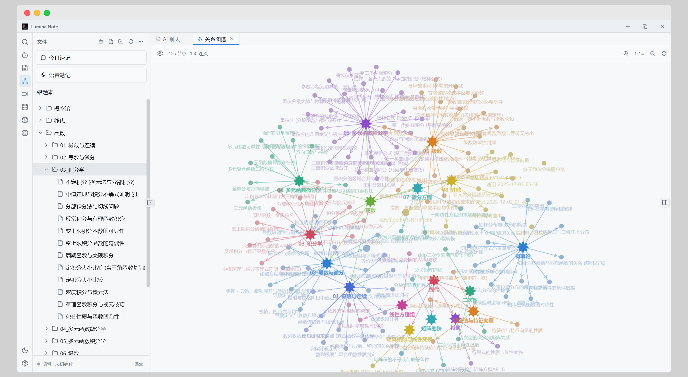
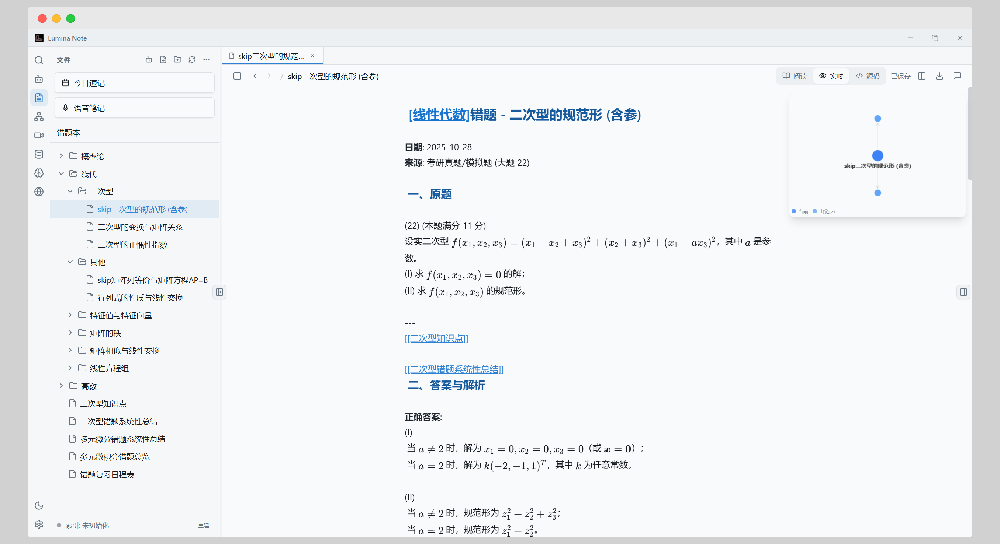

<div align="center">


# Lumina Note

**Human-editable notes with an agent that can work across your vault**

Lumina Note starts as a fast, local Markdown workspace that stays comfortable for people to read and edit directly. On top of that, it embeds an agent powered by the opencode SDK, giving AI the ability to understand and operate across the whole note vault with your permission.

[](https://github.com/blueberrycongee/Lumina-Note/releases)
[](LICENSE)
[](https://www.electronjs.org/)
[](https://github.com/blueberrycongee/Lumina-Note/actions/workflows/ci.yml)
[](https://github.com/blueberrycongee/Lumina-Note/actions/workflows/security-audit.yml)
[](https://github.com/blueberrycongee/Lumina-Note/releases)
[](https://github.com/blueberrycongee/Lumina-Note/stargazers)


**Languages**: English (canonical) · [简体中文](./README.zh-CN.md) · [繁體中文](./README.zh-TW.md) · [日本語](./README.ja.md) · [한국어](./README.ko.md) · [Español](./README.es.md) · [Français](./README.fr.md) · [Deutsch](./README.de.md) · [Italiano](./README.it.md) · [Português (Brasil)](./README.pt-BR.md) · [Русский](./README.ru.md)

</div>

---

## Why Lumina Note

Lumina is built around a simple idea: notes should remain human-owned and human-editable, while AI should be able to help with real work inside the same workspace.

- **Human-first editing**: your vault is plain Markdown on disk. You can open, read, edit, move, and back it up without depending on Lumina or any model provider.
- **Agent-native assistance**: Lumina embeds an opencode-powered agent that can read, write, reorganize, summarize, connect, and research notes across the vault when you ask it to.
- **Knowledge structure that stays visible**: WikiLinks, backlinks, graph views, PDFs, annotations, images, and flashcards are normal workspace surfaces, not hidden AI-only state.
- **Flexible AI routing**: bring your own provider, use local models through Ollama, connect an OpenAI-compatible endpoint, or use Lumina Cloud if you have a license.

## Screenshots

<p align="center">
  
</p>

<p align="center">
  
</p>

<p align="center">
  
</p>

## What It Does

- Edit notes directly in Markdown with live preview, reading mode, WikiLinks, backlinks, and graph views.
- Ask the built-in agent to work on the vault: draft pages, reorganize folders, summarize PDFs, connect related notes, generate flashcards, or clean up messy knowledge.
- Keep control of model routing with OpenAI, Anthropic Claude, Google Gemini, DeepSeek, Moonshot Kimi, Zhipu GLM, MiMo, Groq, OpenRouter, Ollama, OpenAI-compatible endpoints, or optional Lumina Cloud.
- Build other uses on the same foundation through agent skills, custom commands, and the developer-preview plugin system when you need to extend the app.

## Download

Get the latest build from [Releases](https://github.com/blueberrycongee/Lumina-Note/releases).

| Platform | Package |
| --- | --- |
| Windows | `.exe` NSIS installer |
| macOS Apple Silicon / Intel | `.dmg` / `.zip` |
| Linux x64 | `.AppImage` |

## Quick Start

1. Install Lumina Note from Releases.
2. Choose a local folder as your vault.
3. Open **Settings -> AI** and configure a model provider. Use your own API key, Ollama, an OpenAI-compatible endpoint, or a Lumina Cloud license if you have one.
4. Create a note, link it with `[[WikiLinks]]`, and open the graph.
5. Open the AI panel and ask the agent to help with a note, a folder, or a specific writing task.

## Build from Source

Requirements:

- Node.js 22+
- npm
- Bun, only for building the embedded opencode server bundle

Fresh checkout setup:

```bash
git clone https://github.com/blueberrycongee/Lumina-Note.git
cd Lumina-Note
npm install

# Required before npm run dev can resolve virtual:opencode-server.
git clone https://github.com/anomalyco/opencode thirdparty/opencode
(cd thirdparty/opencode && bun install)
npm run opencode:bundle

npm run dev
```

Common commands:

```bash
npm run typecheck
npm run test:run
npm run build
npm run stage:native
npm run dist:mac
npm run dist:win
npm run dist:linux
```

For more detail on the agent runtime setup, see [`docs/agent-runtime-setup.md`](docs/agent-runtime-setup.md).

## For Developers

Lumina is an Electron 41 desktop app with a React 18 / TypeScript renderer and a CodeMirror-based Markdown editor. The agent layer is built on an embedded opencode server and the opencode SDK, with Lumina mapping app settings, vault access, and permission flow into that runtime.

See [`docs/agent-runtime-setup.md`](docs/agent-runtime-setup.md) for the opencode setup, [`docs/plugin-ecosystem.md`](docs/plugin-ecosystem.md) for plugin work, and [`mobile/README.md`](mobile/README.md) for the native iOS / Android companions.

## Documentation

- User guide: [`docs/user-flow.md`](docs/user-flow.md)
- 简体中文用户指南: [`docs/user-flow.zh-CN.md`](docs/user-flow.zh-CN.md)
- Agent runtime setup: [`docs/agent-runtime-setup.md`](docs/agent-runtime-setup.md)
- Self-hosted relay: [`docs/self-host.md`](docs/self-host.md)
- Plugin ecosystem: [`docs/plugin-ecosystem.md`](docs/plugin-ecosystem.md)
- Appearance plugin guide: [`docs/appearance-plugin-guide.md`](docs/appearance-plugin-guide.md)
- Mobile apps: [`mobile/README.md`](mobile/README.md)

## Open Source Components

- Editor core: [codemirror-live-markdown](https://github.com/blueberrycongee/codemirror-live-markdown)
- Agent runtime foundation: [opencode](https://github.com/anomalyco/opencode)

## Contributors

<a href="https://github.com/blueberrycongee/Lumina-Note/graphs/contributors">
  
</a>

## License

[Apache License 2.0](LICENSE)

## Star History

[](https://star-history.dera.page/#blueberrycongee/Lumina-Note&Date)
